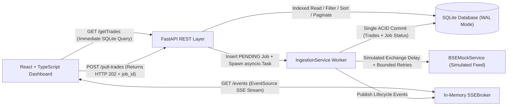
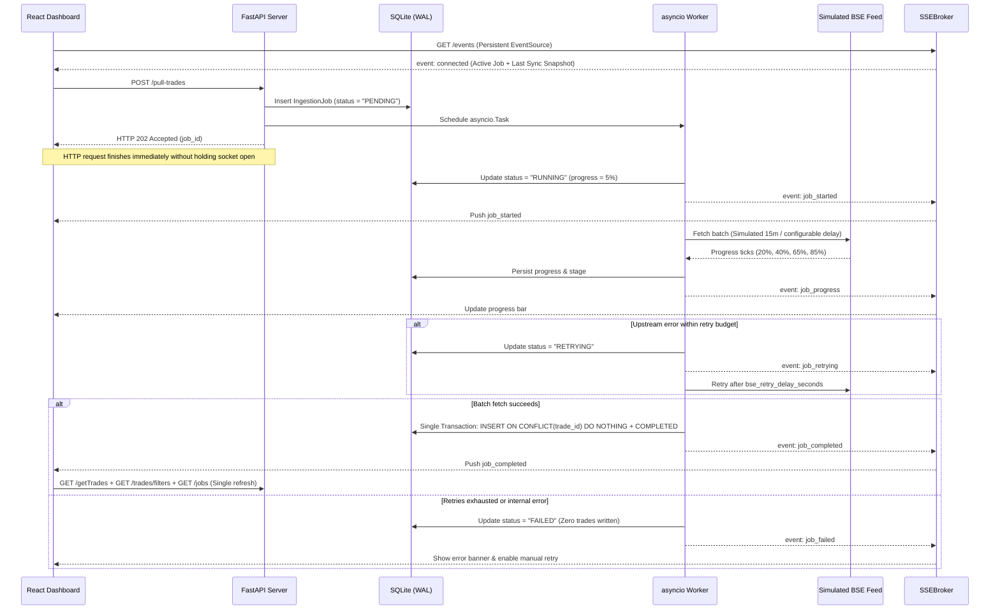

# System Architecture — Arham Fintech BSE Trade Operations Dashboard

## 1. High-Level Architecture Diagram

The system separates immediate dashboard reads from high-latency exchange ingestion using a local SQLite ledger (WAL mode), an asynchronous background worker coordinator, and Server-Sent Events (SSE) for real-time browser synchronization.

---

## 2. Request Lifecycle

### Read Path (`GET /getTrades` and `GET /trades/filters`)

1. The browser sends `GET /getTrades` with pagination (`page`, `page_size`), optional `search`, exact `symbol`/`client` filters, and sort column/direction (`sort_by`, `sort_order`).
2. [`read_trades`](./backend/app/routers/trades.py) opens a SQLite session via dependency injection and delegates to [`get_trades`](./backend/app/services/trade_service.py).
3. SQLite WAL mode lets reads proceed immediately alongside any running background write/delay without waiting for ingestion.
4. Queries return both `summary` (global ledger totals for KPIs) and `filtered_summary` (matching subset totals), plus paginated `TradeItem` rows.

### Ingestion Command Path (`POST /pull-trades`)

1. The browser (or API client) sends `POST /pull-trades`.
2. [`IngestionService.start_pull_job`](./backend/app/services/ingestion_service.py) acquires an in-process `asyncio.Lock`.
3. It checks `ingestion_jobs` for active rows (`PENDING`, `RUNNING`, `RETRYING`). If one exists—or if the SQLite partial unique index `ix_ingestion_jobs_single_active` raises an `IntegrityError`—the API returns `409 Conflict` with the running `active_job_id`.
4. Otherwise, it commits a new `IngestionJob` row (`status = "PENDING"`), schedules `asyncio.create_task(self._execute_job(job_id))` on FastAPI's event loop, emits `job_queued` over `SSEBroker`, and immediately returns HTTP `202 Accepted` with `{ job_id, status, message, estimated_delay_seconds, batch_size, max_retries, created_at }`.

---

## 3. Background Ingestion Lifecycle

State transitions persisted in `ingestion_jobs`:
- `PENDING`: Job row committed and queued onto the event loop.
- `RUNNING`: Worker started (`started_at` stamped) and advancing through simulated gateway milestones (`20%`, `40%`, `65%`, `85%`).
- `RETRYING`: Transient `BSEUpstreamError` caught with remaining retry budget; waits `bse_retry_delay_seconds` before next attempt.
- `COMPLETED`: Staged `RawTradeRecord` batch written atomically alongside `progress = 100`, `records_fetched`, `records_inserted`, `duplicates_skipped`, and `completed_at`.
- `FAILED`: Retries exhausted or server restarted mid-pull; zero partial trades committed.

---

## 4. SSE Event Lifecycle (`GET /events`)

1. **Subscription & Initial Snapshot:** When [`stream_events`](./backend/app/routers/events.py) handles `GET /events`, it registers a bounded `asyncio.Queue` (size 100) in [`SSEBroker`](./backend/app/services/sse_broker.py) and immediately yields an initial `connected` event containing `active_job`, `latest_job`, `last_successful_sync`, and `server_time`.
2. **Lifecycle Fan-Out:** As the ingestion worker transitions state, it calls `sse_broker.publish(...)`, formatting wire frames (`id`, `event`, JSON `data`) and pushing them non-blockingly to every subscribed client queue.
3. **Keepalive Heartbeats:** If no job events occur within `SSE_HEARTBEAT_SECONDS` (default 15s), the stream emits `: heartbeat\n\n` comments to keep reverse proxy connections alive.
4. **Client Handling & Single Refresh:** [`useTradeEvents`](./frontend/src/hooks/useTradeEvents.ts) opens native browser `EventSource`, updates active banner state on `job_queued` / `job_started` / `job_progress` / `job_retrying`, and executes one refresh (`GET /getTrades`, `GET /trades/filters`, `GET /jobs`) upon `job_completed` (with zero `setInterval` polling).
5. **Cleanup & Reconnection:** When a browser tab closes, FastAPI detects disconnect / cancellation and `finally: await sse_broker.unsubscribe(queue)` releases the queue cleanly. If the stream drops transiently and reconnects, `handleConnected` inspects `active_job` and `latest_job` to reconcile completions or failures that happened while disconnected.

---

## 5. How the 30-Second HTTP Limitation Is Avoided

| Aspect | Naive Synchronous Pull | Asynchronous Ingestion + SSE Architecture |
| :--- | :--- | :--- |
| **HTTP Request Duration** | `POST /pull-trades` held open for 900s (fails at 30–60s proxy timeout) | `POST /pull-trades` commits `PENDING` row and returns `202 Accepted` in milliseconds |
| **Server Worker Occupancy** | Request handler tied up sleeping or waiting on upstream socket | Simulated delay executes inside `await asyncio.sleep(...)` on background task |
| **Read Availability** | Reads may queue behind long requests or unindexed locks | `GET /getTrades` queries SQLite WAL independently at all times |
| **UI Synchronization** | Browser blocks waiting or spams `setInterval` polling | Single long-lived `EventSource` receives completion push and refreshes once |

---

## 6. SQLite Persistence

- **Engine Pragmas ([`create_db_engine`](./backend/app/database/session.py)):** Every SQLite connection sets `PRAGMA journal_mode=WAL;`, `PRAGMA synchronous=NORMAL;`, `PRAGMA foreign_keys=ON;`, and `PRAGMA busy_timeout=5000;`. WAL lets concurrent dashboard reads run without blocking on writer commits.
- **`trades` Table ([`Trade`](./backend/app/models/trade.py)):** Stores `trade_id` (`UNIQUE`), `client`, `symbol`, `quantity` (`> 0`), `price` (`Numeric(14, 2) > 0`), `timestamp`, `source` (`INITIAL_SEED` or `BSE_PULL`), nullable FK `job_id`, and `created_at`. Includes B-tree indexes on `trade_id`, `client`, `symbol`, `timestamp`, plus composite indexes `(symbol, timestamp)` and `(client, timestamp)`.
- **`ingestion_jobs` Table ([`IngestionJob`](./backend/app/models/ingestion_job.py)):** Stores full job lifecycle state, retry counters, sanitized `error_message`, metrics, and partial unique index `ix_ingestion_jobs_single_active` enforcing at most one row where `status IN ('PENDING', 'RUNNING', 'RETRYING')`.
- **Atomic Ingestion Commits:** [`persist_trades_atomic`](./backend/app/services/ingestion_service.py) deduplicates within the batch and inserts in 200-row chunks via SQLite `INSERT ... ON CONFLICT(trade_id) DO NOTHING`, committing new trades and marking the job `COMPLETED` in one ACID transaction.

---

## 7. Failure and Restart Handling

- **Upstream Retry & Rollback:** Simulated upstream outages (`BSEUpstreamError`) trigger automatic retries up to `bse_max_retries` (`2` by default, `1` in test fixtures). Exhausting retries sets `status = "FAILED"`, stores a sanitized error message, emits `job_failed`, and writes **zero partial trades** because staged records never touch SQLite until batch retrieval succeeds.
- **Process Crash / Restart Recovery:** Because in-process `asyncio.Task` workers cannot survive process termination, FastAPI's startup lifespan runs [`IngestionService.recover_interrupted_jobs`](./backend/app/services/ingestion_service.py). Any job left in `PENDING`, `RUNNING`, or `RETRYING` is marked `FAILED`, releasing `ix_ingestion_jobs_single_active` so subsequent pulls are never deadlocked.
- **Graceful Shutdown:** On shutdown, `IngestionService.shutdown()` cancels running background tasks cleanly and disposes the SQLAlchemy engine.

---

## 8. Scaling Limitations

This design targets single-node local operation without external infrastructure. Production multi-instance deployment would require:

1. **External Task Queue (vs. `asyncio.Task`):** In-process tasks lose execution progress on container restarts and cannot scale independently of API workers. Moving background jobs to **Celery + Redis**, **ARQ**, or **Temporal** provides durable retries across restarts.
2. **Distributed SSE Broker (vs. In-Memory `SSEBroker`):** Local `asyncio.Queue` sets cannot fan out events across multiple Uvicorn workers (`--workers > 1`) or multiple containers. Replacing `SSEBroker` with **Redis Pub/Sub** or **Redis Streams** enables multi-pod delivery and `Last-Event-ID` event replay.
3. **Database Engine (vs. SQLite WAL):** SQLite serializes writes inside a single file on local disk. Migrating `DATABASE_URL` to **PostgreSQL** with connection pooling (e.g., PgBouncer) removes single-writer and single-host limits.
4. **Reverse Proxy & Auth:** Production proxies (Nginx/ALB) require disabled response buffering (`proxy_buffering off`), while endpoints require authentication (JWT/OAuth2), RBAC on `POST /pull-trades`, and request rate limiting.
